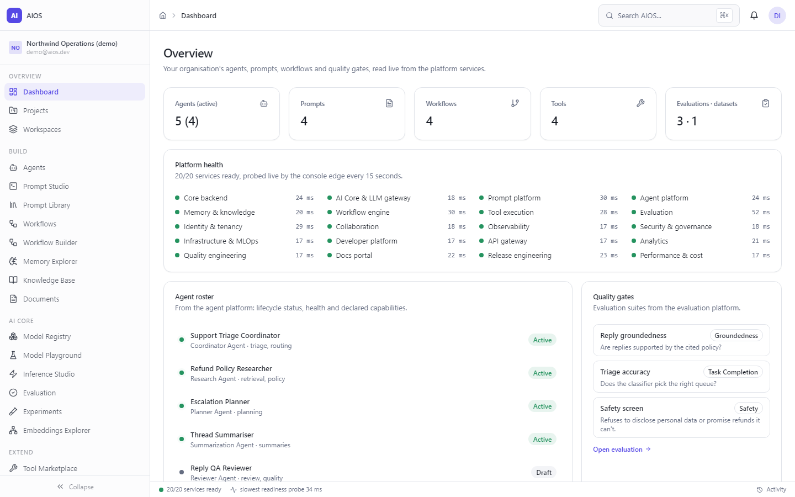
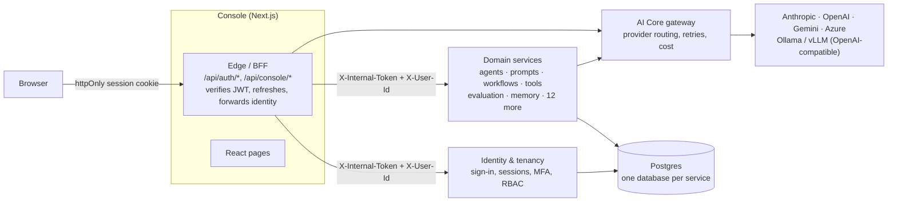
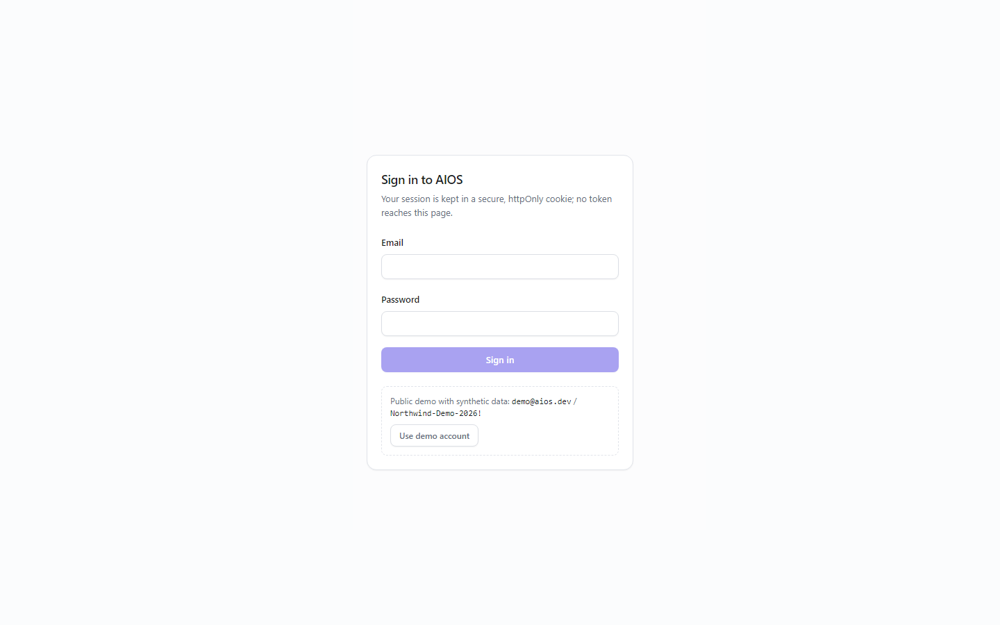
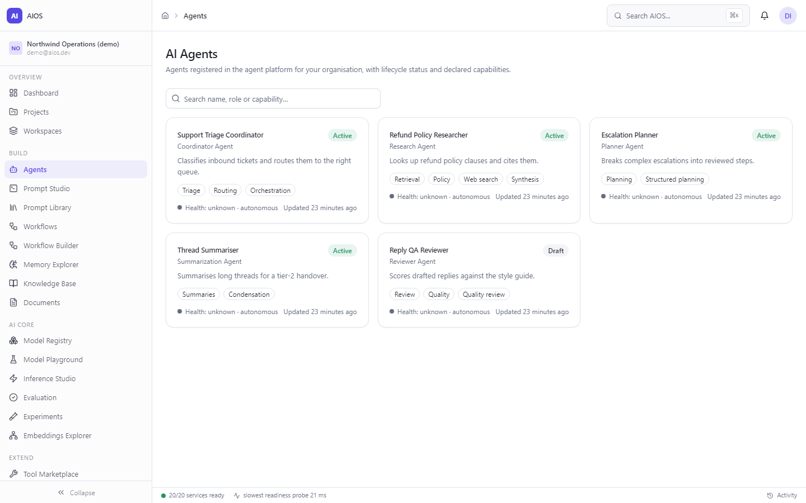
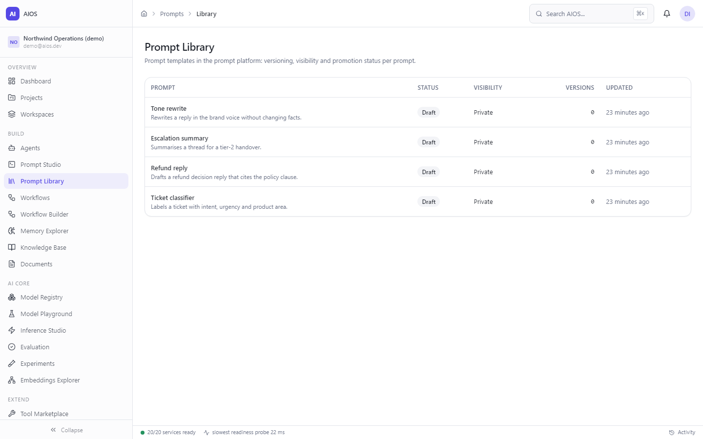
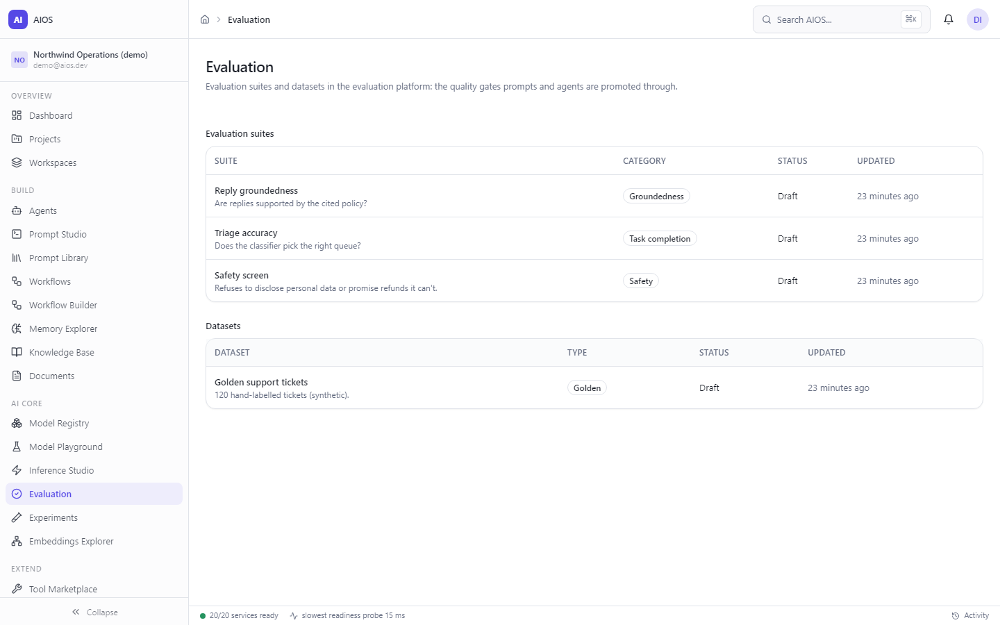
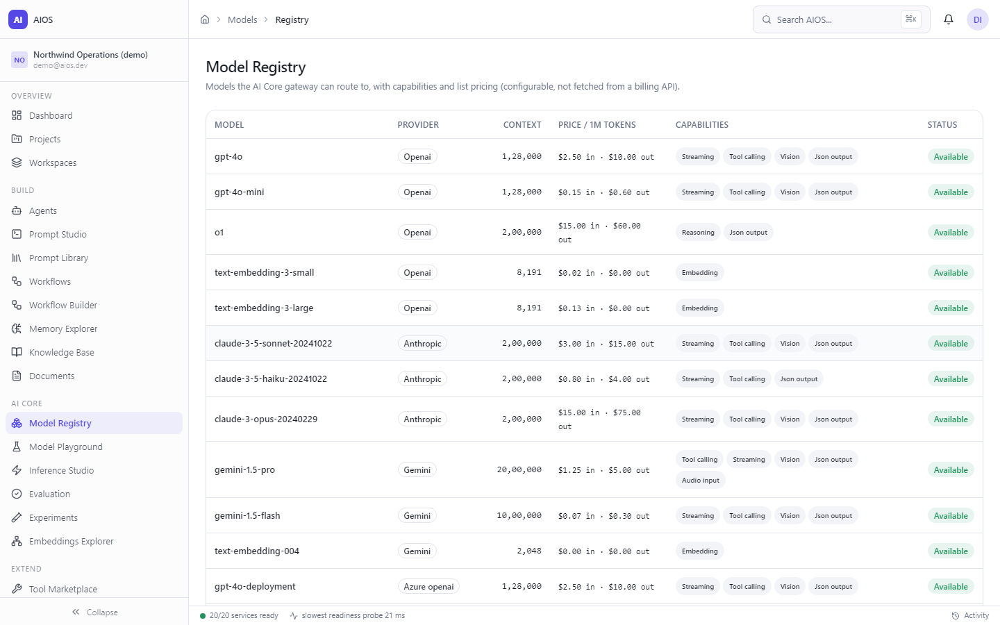
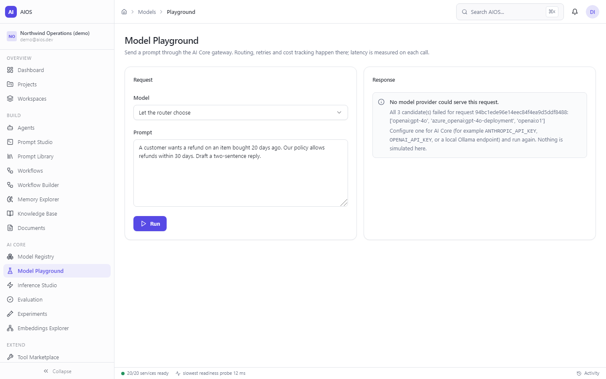

# AIOS: Enterprise AI Operating System

**Live demo: [aios-console.onrender.com](https://aios-console.onrender.com)** — choose *Explore the live demo*. All twenty
services run behind it; see [Hosted demo](#hosted-demo).

AIOS is a microservice platform for running AI agents, prompts, workflows, tools and evaluations inside an
organisation. It is 20 FastAPI services and a Next.js console. The console signs users in through the identity
service and reads every figure on its live pages from the services themselves, through a server-side edge.



**At a glance**

- 20 independently deployable services (identity, agents, prompts, memory, workflows, tools, evaluation, an LLM
  gateway and 12 more), each with its own database, health probes, Dockerfile and Kubernetes manifest.
- A backend-for-frontend edge: httpOnly session cookies, local JWT verification with refresh rotation, and a
  service-to-service token that every service enforces.
- 3,042 backend tests across the 20 services, 46 frontend tests, a live smoke test of the
  whole system, and a browser walkthrough; all run in CI on every push.
- Runs on a laptop without Docker (`scripts/dev.py` starts all twenty on SQLite), or with Docker Compose or Kubernetes
  on Postgres.

## Architecture



Every service follows the same layering: pure-Python domain entities with guarded state machines, SQLAlchemy 2 async
models, repositories behind a unit of work, a service layer, and a FastAPI application factory. Each one exposes
`/health/live` (never touches the database) and `/health/ready` (runs `SELECT 1`, 503 when the database is down).

**Request path.** The browser only ever talks to the console. Signing in posts the password (and an MFA code when the
account has one) to the edge, which calls the identity service's `/auth/token` and stores the access and refresh
tokens in httpOnly, SameSite cookies. Each console API call verifies the access token locally (HS256, short-lived),
rotates it with the refresh token when it has expired, then calls the services server-to-server with the internal
token and the verified user id. The browser never holds a token or a service URL.

## The services

| Service | Port | What it does | Tests |
|---|---|---|---|
| `aios-identity-platform` | 8008 | Registration, email verification, password and MFA (TOTP, recovery codes) sign-in, sessions with refresh rotation, organisations, workspaces, RBAC, API keys | 198 |
| `aios-agent-platform` | 8003 | Agent registry and lifecycle, task planning, inter-agent messaging, orchestration, reasoning traces, governance and audit | 136 |
| `aios-prompt-platform` | 8002 | Prompt authoring, versioning, testing, LLM-judge evaluation, experiments, approval and promotion | 148 |
| `aios-ai-core` | 8001 | LLM gateway: provider abstraction, model routing and fallback, retries, streaming, embeddings, tool calling, cost tracking | 126 |
| `aios-memory-platform` | 8004 | Memory types, document intelligence, vector-store abstraction, retrieval, knowledge graph | 184 |
| `aios-workflow-engine` | 8005 | Workflow graphs, execution engine, events, scheduler, human-in-the-loop approvals | 217 |
| `aios-tool-platform` | 8006 | Tool registry, typed connectors, credential vault, rlimit sandbox for code execution | 249 |
| `aios-evaluation-platform` | 8007 | Evaluation suites, datasets, metrics, hallucination checks, benchmarks | 218 |
| `aios-security-platform` | 8011 | Policy engine, PII/DLP, secrets detection, prompt-injection and threat detection | 135 |
| `aios-observability-platform` | 8010 | Metrics, tracing, alerting, incident management | 102 |
| `aios-api-gateway-platform` | 8014 | Circuit breakers, traffic management, protocol translation, integration hub | 194 |
| `aios-developer-platform` | 8013 | API keys, SDK generation, CLI, plugin SDK, webhooks, MCP integration | 186 |
| `aios-infrastructure-platform` | 8012 | Containers, CI/CD, model lifecycle, feature store | 129 |
| `aios-analytics-platform` | 8015 | Warehouse, KPIs, forecasting, executive reporting | 157 |
| `aios-quality-platform` | 8016 | Test pyramid, chaos experiments, release certification | 155 |
| `aios-release-platform` | 8018 | Versioning, rollouts, feature flags, licensing | 166 |
| `aios-perf-platform` | 8019 | Caching, LLM cost routing, budgets, optimisation recommendations | 93 |
| `aios-collaboration-platform` | 8009 | Presence, comments, versioning, reviews | 73 |
| `aios-docs-platform` | 8017 | Documentation portal and learning paths | 141 |
| `aios-backend` | 8000 | General-purpose backend: auth, orgs, RBAC, background workers | 35 |
| `aios-frontend` | 3000 | The console and its edge | 46 |

Each service has its own README with its modules, API surface and design notes.

## What is live in the console

Dashboard, Agents, Prompt Library, Workflows, Tools, Evaluation, Model Registry and Model Playground read live data
through the edge. The dashboard's platform-health card and the status bar probe all twenty services every 15 seconds
and show measured latency. The Model Playground sends real requests through the AI Core gateway; with no provider
configured it shows the gateway's own error, and nothing is simulated.

The remaining screens (analytics, memory explorer, workflow builder and others) are complete designs that are not wired
to their services yet. Every one of them carries a visible "Preview: illustrative data" banner, so nothing on them can
be mistaken for live figures.

| | |
|---|---|
|  Sign-in, with the demo account |  Agents from the agent platform |
|  Prompt library |  Evaluation suites and datasets |
|  Model registry from AI Core |  Playground with no provider configured |

## Security model

- **Service edge guard.** With `AIOS_INTERNAL_TOKEN` set, every route except `/health*` requires a matching
  `X-Internal-Token` (constant-time comparison); anything else gets 401 before it reaches a router. With
  `APP_ENV=production` a service refuses to start without a token of at least 32 characters. CORS is off unless
  `AIOS_CORS_ORIGINS` lists origins, because browsers reach services only through the edge.
- **Sessions.** Access tokens live 15 minutes and refresh tokens 30 days, in httpOnly, SameSite=Lax cookies (Secure in
  production). Sign-out revokes the session in the identity service, so the refresh token stops working everywhere.
- **Sign-in.** `/auth/token` checks the password, lockout and email verification, then the TOTP or recovery code when
  the account has MFA, and only then issues a session. Wrong password, unknown email and unverified account all get the
  same answer, so the endpoint can't be used to enumerate accounts. The post-login redirect accepts same-site paths only.
- **Fail-closed configuration.** The identity service refuses to start in production with its public development
  signing key or any key under 32 characters; the console refuses to verify sessions in production without
  `AIOS_JWT_SECRET`. Compose and the Kubernetes templates require both secrets.
- **Sandboxed tools.** Code-execution tools run in a subprocess with CPU and memory rlimits and a wall-clock timeout.
  Where rlimits don't exist (Windows) the sandbox refuses to run anything rather than run it unconfined.

## Hosted demo

The [live demo](https://aios-console.onrender.com) runs on Render's free tier, which gives each service 512 MB. Twenty
separate Python processes would need well over a gigabyte, so the demo API runs all twenty services in one process
([`deploy/demo/combined.py`](deploy/demo/combined.py)) and the console runs as its own service:

- **Same services, one interpreter.** `combined.py` imports each service's unmodified FastAPI application and serves it
  under `/svc/<name>` with the prefix stripped, so every service sees exactly the routes and health-probe exemptions it
  sees on its own port. Each keeps its own SQLite database and enforces `X-Internal-Token`; the console reaches them
  through `AIOS_SERVICES_BASE_URL`. Measured: about 220 MB resident for all twenty, ready in seconds.
- **Seeded through the APIs.** At image build time [`deploy/demo/demo_build.py`](deploy/demo/demo_build.py) starts the
  platform and runs `scripts/seed_demo.py` against it: the Northwind Operations organisation with its agents, prompts,
  workflows, tools, evaluations and datasets. Every start copies that showcase afresh
  ([`deploy/demo/demo_start.py`](deploy/demo/demo_start.py)).
- **Guest sign-in, no published account.** *Explore the live demo* calls the edge's `/api/auth/guest`, which asks the
  identity service's `POST /auth/guest` (off unless `GUEST_ACCESS_ENABLED`, reachable only with the internal token) for a
  session for an ordinary member of the demo organisation. It refuses an account that owns an organisation or holds an
  administrative role. The seeded owner, `demo@aios.dev`, has a random password nobody knows unless you set
  `AIOS_OWNER_PASSWORD` as a hosting secret.
- **Secrets.** `render.yaml` generates the internal token and the identity signing key once and shares them with the
  console (`AIOS_INTERNAL_TOKEN`, `AIOS_JWT_SECRET`); nothing secret is committed.
- **Model Playground.** No AI provider key is configured, so it shows the gateway's own error, as described above. Add
  `ANTHROPIC_API_KEY` (or another provider) to the API service to make it generate.
- **Free-tier behaviour.** Both services sleep when idle; the first visit after a pause takes about a minute.

A real deployment runs every service separately: `docker-compose.yml` or `k8s/`.

## Run it

### Locally, without Docker

You need Python 3.11 and Node 22.

```bash
python -m venv .venv && source .venv/bin/activate        # Windows: .venv\Scripts\activate
pip install -e aios-ai-core && grep -hv '^-e' aios-*/requirements.txt | sort -u | pip install -r /dev/stdin

export AIOS_INTERNAL_TOKEN=local-dev-internal-token-0123456789abcdef
python scripts/dev.py            # starts all 20 services on ports 8000-8019 (SQLite under var/)
python scripts/seed_demo.py      # demo organisation with agents, prompts, workflows, tools and evaluations
python scripts/smoke_test.py     # readiness, write persistence and the edge guard, over real HTTP

cd aios-frontend && npm ci
AIOS_INTERNAL_TOKEN=$AIOS_INTERNAL_TOKEN npm run dev   # http://localhost:3000
```

Sign in with the local demo account `seed_demo.py` prints at the end (local development only; the hosted demo
publishes no account and uses a guest session instead). To use the playground, give AI Core a provider: for example
`ANTHROPIC_API_KEY`, `OPENAI_API_KEY`, or an Ollama endpoint (see `aios-ai-core/README.md`).

### Docker Compose

```bash
cp .env.example .env          # set AIOS_INTERNAL_TOKEN and AIOS_JWT_SECRET (generate with the command in the file)
docker compose up --build     # Postgres, all 20 services on 8000-8019, the console on 3000
```

### Kubernetes

`k8s/` has a Deployment and Service per service (liveness and readiness wired to the health endpoints), a Postgres
StatefulSet and two Secret templates in `k8s/secrets.example.yaml`: database URLs, and the internal token and signing
key. Copy it to `secrets.yaml` (git-ignored), fill it in and apply it before the Deployments.

## Testing and verification

| Check | Result (2026-11-03) |
|---|---|
| Backend: `python scripts/test_all.py` (each service's own suite) | 3,042 passed, 0 failed, across 20 services; 12 sandbox tests skip on Windows because they need POSIX rlimits, and run on Linux CI |
| Lint: `ruff check` in every service | clean |
| Frontend: `npm run typecheck && npm run lint && npm test && npm run build` | clean; 39 tests |
| System smoke test against all 20 running services | readiness 20/20, writes persist in every workspace service, edge guard enforced |
| Browser walkthrough of the production build (Chromium) | sign-in, every live page, playground, preview labelling; no console errors |
| `pip-audit` (every service) and `npm audit` (dev dependencies included) | 0 known vulnerabilities |

CI (`.github/workflows/ci.yml`) runs lint, tests and a dependency audit for each service in parallel, the frontend
checks, and an integration job that starts all twenty services, runs the smoke test and seeds the demo twice to prove
the seed is idempotent.

### Defects found and fixed while hardening

- **Lost writes.** Sixteen services opened a database session per request but never committed it, so every write made
  through their HTTP APIs returned 201 and was then rolled back. Unit tests couldn't see it because they commit on
  their own sessions; the smoke test now checks write persistence in every workspace service.
- **Unauthenticated session minting.** The identity service's `POST /sessions` issued tokens for any user id with no
  credentials. Sign-in now goes through `/auth/token`, and every service sits behind the edge guard.
- **Credentialed wildcard CORS.** Every service allowed any origin with credentials. CORS is now opt-in per origin.
- **Unstable ordering.** Rows written in the same clock tick could list in either order on Windows. Each service now
  takes every timestamp from one strictly increasing clock (`<package>/clock.py`), which also keeps durations from going
  negative.
- **Development signing key in production.** Compose ran the identity service without `SECRET_KEY`, so it signed
  tokens with its public development default. It now refuses to start that way.

## Disclosed scope boundaries

- **Console coverage.** Eight console screens are live; the rest are labelled previews (see above).
- **Schema management.** The domain services use `create_all()` at startup, which suits SQLite development and this
  reference build; only `aios-backend` has Alembic migrations.
- **`aios-backend` workers** run real orchestration code with the model call left as a documented stub; the real
  capability lives in AI Core and the domain services.
- **Encryption keys** (the security platform's master key, the tool vault) come from environment variables here; a real
  deployment should source them from a KMS.
- **Infrastructure and pricing.** Multi-cloud settings in the infrastructure platform are configuration values, not
  live cloud integrations, and unit costs in the performance platform and the model registry are configurable list
  prices, not fetched from a billing API.

## License

[MIT](LICENSE)
